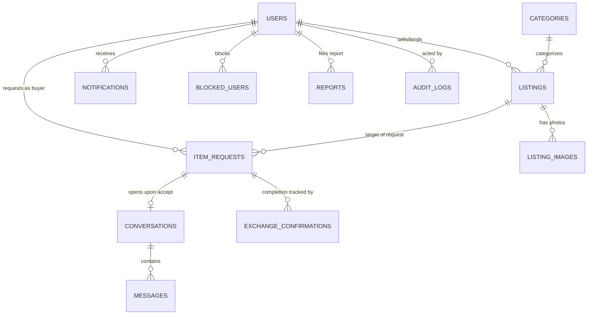

# Database Design Specification — Campus Exchange

**Document Version:** 1.0  
**RDBMS:** PostgreSQL 15+ (with H2 dev profile compatibility)  
**Schema Definition Strategy:** Flyway Migrations (`src/main/resources/db/migration/`)  
**Identifier Strategy:** UUID primary keys for entities (or robust Long sequence with UUID public tokens)  

---

## 1. Entity-Relationship (ER) Diagram



---

## 2. Detailed Table Specifications

### 2.1 `users`
Stores student accounts and administrative users.
```sql
CREATE TABLE users (
    id UUID PRIMARY KEY DEFAULT gen_random_uuid(),
    full_name VARCHAR(100) NOT NULL,
    email VARCHAR(255) NOT NULL UNIQUE,
    password_hash VARCHAR(255) NOT NULL,
    profile_image_url VARCHAR(1000),
    department VARCHAR(100),
    course VARCHAR(100),
    study_year VARCHAR(20),
    role VARCHAR(20) NOT NULL DEFAULT 'USER',            -- 'USER', 'ADMIN'
    verified BOOLEAN NOT NULL DEFAULT FALSE,
    account_status VARCHAR(20) NOT NULL DEFAULT 'ACTIVE', -- 'ACTIVE', 'SUSPENDED', 'DEACTIVATED'
    created_at TIMESTAMP WITH TIME ZONE NOT NULL DEFAULT CURRENT_TIMESTAMP,
    updated_at TIMESTAMP WITH TIME ZONE NOT NULL DEFAULT CURRENT_TIMESTAMP
);

CREATE INDEX idx_users_email ON users(email);
CREATE INDEX idx_users_status ON users(account_status);
```

### 2.2 `email_verification_tokens`
Tracks single-use, time-limited tokens for university email verification.
```sql
CREATE TABLE email_verification_tokens (
    id UUID PRIMARY KEY DEFAULT gen_random_uuid(),
    user_id UUID NOT NULL REFERENCES users(id) ON DELETE CASCADE,
    token_hash VARCHAR(64) NOT NULL UNIQUE,             -- SHA-256 hash of plaintext token
    expires_at TIMESTAMP WITH TIME ZONE NOT NULL,
    used_at TIMESTAMP WITH TIME ZONE,
    created_at TIMESTAMP WITH TIME ZONE NOT NULL DEFAULT CURRENT_TIMESTAMP
);

CREATE INDEX idx_email_token_hash ON email_verification_tokens(token_hash);
```

### 2.3 `password_reset_tokens`
Tracks password recovery attempts.
```sql
CREATE TABLE password_reset_tokens (
    id UUID PRIMARY KEY DEFAULT gen_random_uuid(),
    user_id UUID NOT NULL REFERENCES users(id) ON DELETE CASCADE,
    token_hash VARCHAR(64) NOT NULL UNIQUE,
    expires_at TIMESTAMP WITH TIME ZONE NOT NULL,
    used_at TIMESTAMP WITH TIME ZONE,
    created_at TIMESTAMP WITH TIME ZONE NOT NULL DEFAULT CURRENT_TIMESTAMP
);

CREATE INDEX idx_pwd_token_hash ON password_reset_tokens(token_hash);
```

### 2.4 `categories`
Managed catalog taxonomy.
```sql
CREATE TABLE categories (
    id BIGSERIAL PRIMARY KEY,
    name VARCHAR(100) NOT NULL UNIQUE,
    slug VARCHAR(120) NOT NULL UNIQUE,
    description VARCHAR(500),
    image_url VARCHAR(1000),
    active BOOLEAN NOT NULL DEFAULT TRUE,
    display_order INT NOT NULL DEFAULT 0,
    created_at TIMESTAMP WITH TIME ZONE NOT NULL DEFAULT CURRENT_TIMESTAMP,
    updated_at TIMESTAMP WITH TIME ZONE NOT NULL DEFAULT CURRENT_TIMESTAMP
);

CREATE INDEX idx_categories_active ON categories(active, display_order);
```

### 2.5 `listings`
Products listed for sale, rent, or lending.
```sql
CREATE TABLE listings (
    id UUID PRIMARY KEY DEFAULT gen_random_uuid(),
    seller_id UUID NOT NULL REFERENCES users(id) ON DELETE RESTRICT,
    category_id BIGINT NOT NULL REFERENCES categories(id) ON DELETE RESTRICT,
    title VARCHAR(150) NOT NULL,
    description TEXT NOT NULL,
    condition VARCHAR(20) NOT NULL,                      -- 'NEW', 'LIKE_NEW', 'GOOD', 'FAIR'
    transaction_type VARCHAR(20) NOT NULL,               -- 'SELL', 'RENT', 'LEND'
    quantity_total INT NOT NULL CHECK (quantity_total > 0),
    quantity_available INT NOT NULL CHECK (quantity_available >= 0),
    quantity_reserved INT NOT NULL DEFAULT 0 CHECK (quantity_reserved >= 0),
    price NUMERIC(10, 2) NOT NULL DEFAULT 0.00,
    price_basis VARCHAR(20) NOT NULL DEFAULT 'NONE',     -- 'NONE', 'PER_DAY', 'PER_WEEK', 'PER_MONTH'
    status VARCHAR(20) NOT NULL DEFAULT 'AVAILABLE',     -- 'AVAILABLE', 'RESERVED', 'UNAVAILABLE', 'COMPLETED', 'REMOVED'
    version BIGINT NOT NULL DEFAULT 0,                   -- Optimistic lock support
    created_at TIMESTAMP WITH TIME ZONE NOT NULL DEFAULT CURRENT_TIMESTAMP,
    updated_at TIMESTAMP WITH TIME ZONE NOT NULL DEFAULT CURRENT_TIMESTAMP,
    
    CONSTRAINT chk_qty_consistency CHECK (quantity_available + quantity_reserved <= quantity_total),
    CONSTRAINT chk_sell_price CHECK (transaction_type <> 'SELL' OR price > 0),
    CONSTRAINT chk_rent_price CHECK (transaction_type <> 'RENT' OR (price > 0 AND price_basis IN ('PER_DAY', 'PER_WEEK', 'PER_MONTH')))
);

CREATE INDEX idx_listings_search ON listings(status, transaction_type, category_id, created_at DESC);
CREATE INDEX idx_listings_seller ON listings(seller_id);
```

### 2.6 `listing_images`
Product photo gallery supporting up to 5 images per listing.
```sql
CREATE TABLE listing_images (
    id UUID PRIMARY KEY DEFAULT gen_random_uuid(),
    listing_id UUID NOT NULL REFERENCES listings(id) ON DELETE CASCADE,
    image_url VARCHAR(1000) NOT NULL,
    storage_key VARCHAR(500) NOT NULL,
    is_primary BOOLEAN NOT NULL DEFAULT FALSE,
    display_order INT NOT NULL DEFAULT 0,
    created_at TIMESTAMP WITH TIME ZONE NOT NULL DEFAULT CURRENT_TIMESTAMP
);

CREATE INDEX idx_listing_images_listing ON listing_images(listing_id, display_order);
```

### 2.7 `item_requests`
Requests sent by buyers to sellers.
```sql
CREATE TABLE item_requests (
    id UUID PRIMARY KEY DEFAULT gen_random_uuid(),
    listing_id UUID NOT NULL REFERENCES listings(id) ON DELETE RESTRICT,
    buyer_id UUID NOT NULL REFERENCES users(id) ON DELETE RESTRICT,
    seller_id UUID NOT NULL REFERENCES users(id) ON DELETE RESTRICT,
    quantity_requested INT NOT NULL CHECK (quantity_requested > 0),
    introductory_message VARCHAR(500),
    status VARCHAR(20) NOT NULL DEFAULT 'PENDING',        -- 'PENDING', 'ACCEPTED', 'DECLINED', 'CANCELLED', 'EXPIRED', 'COMPLETED'
    accepted_at TIMESTAMP WITH TIME ZONE,
    declined_at TIMESTAMP WITH TIME ZONE,
    expires_at TIMESTAMP WITH TIME ZONE NOT NULL,        -- Now + 72 Hours
    created_at TIMESTAMP WITH TIME ZONE NOT NULL DEFAULT CURRENT_TIMESTAMP,
    updated_at TIMESTAMP WITH TIME ZONE NOT NULL DEFAULT CURRENT_TIMESTAMP
);

CREATE INDEX idx_requests_buyer ON item_requests(buyer_id, status);
CREATE INDEX idx_requests_seller ON item_requests(seller_id, status);
CREATE INDEX idx_requests_listing ON item_requests(listing_id, status);
CREATE INDEX idx_requests_expiry ON item_requests(status, expires_at);
```

### 2.8 `conversations`
Gated private chat thread created upon request acceptance.
```sql
CREATE TABLE conversations (
    id UUID PRIMARY KEY DEFAULT gen_random_uuid(),
    request_id UUID NOT NULL UNIQUE REFERENCES item_requests(id) ON DELETE CASCADE,
    buyer_id UUID NOT NULL REFERENCES users(id) ON DELETE RESTRICT,
    seller_id UUID NOT NULL REFERENCES users(id) ON DELETE RESTRICT,
    created_at TIMESTAMP WITH TIME ZONE NOT NULL DEFAULT CURRENT_TIMESTAMP,
    updated_at TIMESTAMP WITH TIME ZONE NOT NULL DEFAULT CURRENT_TIMESTAMP
);

CREATE INDEX idx_conversations_participants ON conversations(buyer_id, seller_id);
```

### 2.9 `messages`
Text messages exchanged within a conversation.
```sql
CREATE TABLE messages (
    id UUID PRIMARY KEY DEFAULT gen_random_uuid(),
    conversation_id UUID NOT NULL REFERENCES conversations(id) ON DELETE CASCADE,
    sender_id UUID NOT NULL REFERENCES users(id) ON DELETE RESTRICT,
    message_text VARCHAR(2000) NOT NULL,
    created_at TIMESTAMP WITH TIME ZONE NOT NULL DEFAULT CURRENT_TIMESTAMP
);

CREATE INDEX idx_messages_conversation ON messages(conversation_id, created_at ASC);
```

### 2.10 `blocked_users`
Bidirectional communication blockage.
```sql
CREATE TABLE blocked_users (
    id UUID PRIMARY KEY DEFAULT gen_random_uuid(),
    blocker_id UUID NOT NULL REFERENCES users(id) ON DELETE CASCADE,
    blocked_user_id UUID NOT NULL REFERENCES users(id) ON DELETE CASCADE,
    created_at TIMESTAMP WITH TIME ZONE NOT NULL DEFAULT CURRENT_TIMESTAMP,

    CONSTRAINT uq_blocker_blocked UNIQUE (blocker_id, blocked_user_id),
    CONSTRAINT chk_no_self_block CHECK (blocker_id <> blocked_user_id)
);
```

### 2.11 `reports`
Moderation flags submitted by users.
```sql
CREATE TABLE reports (
    id UUID PRIMARY KEY DEFAULT gen_random_uuid(),
    reporter_id UUID NOT NULL REFERENCES users(id) ON DELETE RESTRICT,
    reported_user_id UUID REFERENCES users(id) ON DELETE SET NULL,
    listing_id UUID REFERENCES listings(id) ON DELETE SET NULL,
    reason VARCHAR(50) NOT NULL,                         -- 'INAPPROPRIATE', 'MISLEADING', 'SPAM', 'HARASSMENT', 'PROHIBITED', 'SCAM', 'OTHER'
    description TEXT,
    status VARCHAR(20) NOT NULL DEFAULT 'PENDING',        -- 'PENDING', 'UNDER_REVIEW', 'RESOLVED', 'DISMISSED'
    admin_notes TEXT,
    reviewed_by UUID REFERENCES users(id) ON DELETE SET NULL,
    reviewed_at TIMESTAMP WITH TIME ZONE,
    created_at TIMESTAMP WITH TIME ZONE NOT NULL DEFAULT CURRENT_TIMESTAMP,

    CONSTRAINT chk_report_target CHECK (reported_user_id IS NOT NULL OR listing_id IS NOT NULL)
);

CREATE INDEX idx_reports_status ON reports(status, created_at DESC);
```

### 2.12 `notifications`
In-app user alerts.
```sql
CREATE TABLE notifications (
    id UUID PRIMARY KEY DEFAULT gen_random_uuid(),
    user_id UUID NOT NULL REFERENCES users(id) ON DELETE CASCADE,
    type VARCHAR(50) NOT NULL,                           -- 'REQUEST_RECEIVED', 'REQUEST_ACCEPTED', 'REQUEST_DECLINED', 'REQUEST_EXPIRED', 'NEW_MESSAGE', 'LISTING_REMOVED', 'ACCOUNT_FLAGGED'
    title VARCHAR(150) NOT NULL,
    body VARCHAR(500) NOT NULL,
    reference_type VARCHAR(50),                          -- 'LISTING', 'REQUEST', 'CONVERSATION'
    reference_id UUID,
    is_read BOOLEAN NOT NULL DEFAULT FALSE,
    created_at TIMESTAMP WITH TIME ZONE NOT NULL DEFAULT CURRENT_TIMESTAMP
);

CREATE INDEX idx_notifications_user ON notifications(user_id, is_read, created_at DESC);
```

### 2.13 `exchange_confirmations`
Mutual transaction verification between buyer and seller.
```sql
CREATE TABLE exchange_confirmations (
    id UUID PRIMARY KEY DEFAULT gen_random_uuid(),
    request_id UUID NOT NULL REFERENCES item_requests(id) ON DELETE CASCADE,
    confirmed_by UUID NOT NULL REFERENCES users(id) ON DELETE RESTRICT,
    confirmation_type VARCHAR(30) NOT NULL,               -- 'SALE_COMPLETED', 'ITEM_RETURNED'
    confirmed_at TIMESTAMP WITH TIME ZONE NOT NULL DEFAULT CURRENT_TIMESTAMP,

    CONSTRAINT uq_request_party_confirm UNIQUE (request_id, confirmed_by, confirmation_type)
);
```

### 2.14 `audit_logs`
Immutable record of administrative interventions.
```sql
CREATE TABLE audit_logs (
    id UUID PRIMARY KEY DEFAULT gen_random_uuid(),
    actor_id UUID NOT NULL REFERENCES users(id) ON DELETE RESTRICT,
    action VARCHAR(50) NOT NULL,                         -- 'SUSPEND_USER', 'REACTIVATE_USER', 'REMOVE_LISTING', 'RESOLVE_REPORT', 'UPDATE_CATEGORY'
    target_type VARCHAR(50) NOT NULL,
    target_id VARCHAR(100) NOT NULL,
    reason TEXT NOT NULL,
    metadata JSONB,
    created_at TIMESTAMP WITH TIME ZONE NOT NULL DEFAULT CURRENT_TIMESTAMP
);

CREATE INDEX idx_audit_created ON audit_logs(created_at DESC);
```
