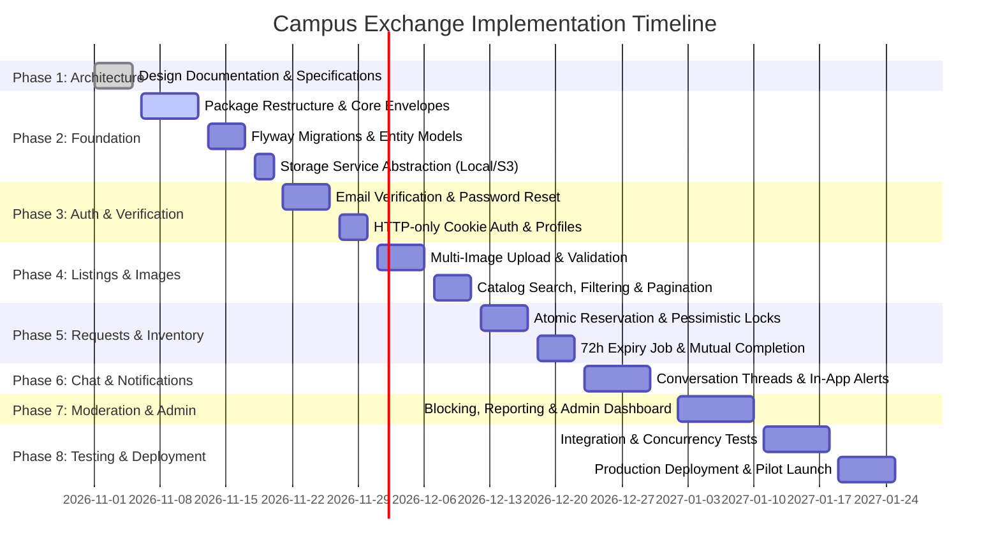

# Implementation Roadmap — Campus Exchange

**Document Version:** 1.0  
**Target Completion:** Phased Modular Milestones  

---

## 1. Overview & Current State Baseline

The repository currently contains an early monolithic prototype with basic CRUD for listings and requests, utilizing an in-memory/H2 file database and single-package structure.

This roadmap transitions the application systematically into the full specification outlined in the Architecture, Database, and Security documents, ensuring that no breaking regressions occur between modules.

---

## 2. Milestone Breakdown

---

## 3. Detailed Phase Deliverables

### Phase 1 — Product & Architecture Design (Completed)
- [x] Complete PRD (`docs/PRD.md`)
- [x] System Architecture & Modular Monolith Design (`docs/SYSTEM_ARCHITECTURE.md`)
- [x] PostgreSQL Database Schema & ER Design (`docs/DATABASE_DESIGN.md`)
- [x] Complete REST API Specifications (`docs/API_SPECIFICATION.md`)
- [x] Visual User Flow Diagrams (`docs/USER_FLOWS.md`)
- [x] Security Architecture & Threat Model (`docs/SECURITY_DESIGN.md`)
- [x] Implementation Roadmap (`docs/IMPLEMENTATION_ROADMAP.md`)
- [x] Test Plan (`docs/TEST_PLAN.md`)

### Phase 2 — Refactoring & Core Foundation
- Reorganize backend into feature-based packages (`config`, `security`, `common`, `auth`, `user`, `category`, `listing`, `request`, `conversation`, `moderation`, `admin`).
- Standardize API response envelopes (`ApiResponse<T>`, `PageResponse<T>`) and `GlobalExceptionHandler`.
- Implement `StorageService` interface with `LocalFileStorageService` for development.
- Configure Flyway migrations and align database constraints.

### Phase 3 — Authentication & Verification
- Implement university email verification token lifecycle (generate, hash, expire, verify).
- Implement password reset workflow with secure one-time tokens.
- Upgrade JWT authentication to HTTP-only, SameSite cookies with Bearer fallback.
- Enforce verified status check on write endpoints (creating listings, sending requests).
- Build frontend screens for registration feedback, email verification status, and password reset.

### Phase 4 — Listings & Multi-Image Gallery
- Create `listing_images` table support with primary image designation and ordering.
- Multi-image upload endpoint with MIME validation, magic byte checking, and 5MB size limit.
- Refactor catalog search to support full parametric filtering (`q`, `type`, `categoryId`, `condition`, `minPrice`, `maxPrice`, `sort`, `page`, `size`).
- Build frontend image upload previewer with primary photo selector.

### Phase 5 — Requests, Concurrency & Mutual Completion
- Harden atomic stock reservation under pessimistic write lock (`@Lock(LockModeType.PESSIMISTIC_WRITE)`).
- Implement scheduled background job (`@Scheduled`) to auto-expire pending requests after 72 hours.
- Implement mutual exchange confirmation (`exchange_confirmations`):
  - Both buyer and seller must confirm sale or return.
  - Final stock reduction (SELL) or stock restoration (RENT/LEND) triggers only on mutual confirmation.
- Build frontend confirmation prompts for completed exchanges.

### Phase 6 — Private Messaging & Notification Center
- Formalize `conversations` entity linked 1:1 with accepted `item_requests`.
- Implement chronological message history and 3-second polling mechanism in frontend.
- Implement in-app notification center for request updates, new messages, and status changes.
- Add unread message indicator and notification bell in navbar.

### Phase 7 — Safety, Moderation & Admin Dashboard
- Implement bidirectional user blocking (`blocked_users`), preventing requests and messages.
- Implement report filing (`reports`) for inappropriate listings or abusive users.
- Implement protected Admin Dashboard:
  - Metric summary cards (users, active listings, pending reports, exchanges).
  - User suspension and reactivation with audit logging.
  - Prohibited listing removal with audit logging.
  - Report resolution and moderation notes.

### Phase 8 — Comprehensive Testing & Hardening
- Backend integration tests with Spring Boot Test and MockMvc.
- Concurrency test simulating multiple simultaneous accept requests for 1 stock item.
- Security boundary verification (IDOR tests, unverified user blocks).
- Frontend responsive testing (mobile and desktop layout).
- Production build validation (`mvn clean package` and `npm run build`).

### Phase 9 — Pilot Launch
- Deploy backend to Java-compatible hosting with managed PostgreSQL.
- Deploy frontend to Vercel/CDN.
- Seed genuine initial listings with campus student volunteers.
- Monitor logs, track exchange completions, and gather user feedback.
