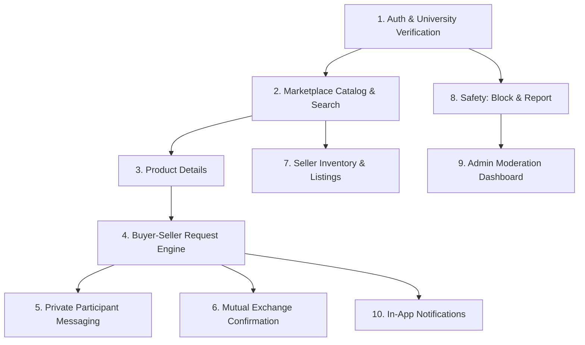

# Product Requirements Document (PRD) — Campus Exchange

**Document Version:** 1.0  
**Project:** Campus Exchange (University Student Marketplace)  
**Status:** Approved for Architectural Implementation  
**Target Pilot:** Single University Campus within 3 months  

---

## 1. Executive Summary & Problem Statement

University students frequently require equipment, books, electronic components, engineering kits, lab apparatus, and course materials. At the same time, senior students or peers often possess these exact items sitting idle after semester completion.

Currently, campus transactions occur through chaotic WhatsApp groups, word-of-mouth, or informal bulletin boards. This presents severe challenges:
- **Low Discoverability:** Items are lost in high-volume chat streams.
- **Lack of Trust:** Informal transactions lack verification, leading to scams or ghosting.
- **Safety & Spam:** Unfiltered public contact information invites harassment and spam.
- **Transaction Ambiguity:** Unclear availability, no reservation mechanism, and accidental double-selling.

**Campus Exchange** is a university-exclusive, student-to-student marketplace web application that allows verified students to **Buy, Sell, Rent, and Lend** items securely within their university campus.

---

## 2. Goals & Non-Goals

### 2.1 Goals (MVP / Pilot Launch)
1. **University Domain Exclusivity:** Restrict registration and interactions strictly to verified university email domains.
2. **Flexible Listing Modalities:** Support permanent sales (`SELL`), temporary rentals with flexible pricing bases (`RENT`), and free/borrowing arrangements (`LEND`).
3. **Structured Request Workflow:** Eliminate unsolicited messaging. Direct chat opens only after a seller explicitly accepts a buyer's request.
4. **Atomic Inventory Safety:** Guarantee that items cannot be oversold, double-reserved, or trapped in inconsistent states during concurrent interactions.
5. **Campus Safety & Privacy:** Never publicly expose student phone numbers or personal emails. Provide robust in-app reporting, user blocking, and an administrator moderation dashboard.
6. **Mutual Exchange Completion:** Verify physical transaction closure before permanently updating inventory or closing agreements.

### 2.2 Non-Goals (MVP Exclusions)
- No online or in-app payment gateway (no Stripe, Razorpay, or escrow); students settle payments directly via cash/UPI at physical exchange.
- No automated rental deposit or penalty calculation engine in v1.
- No multi-university federation or cross-campus shipping.
- No native mobile applications (iOS/Android); responsive progressive web design is prioritized.
- No AI recommendation engines, public comments, or social login.

---

## 3. Target User Personas

| Persona | Role | Key Needs & Pain Points |
|---|---|---|
| **Student Buyer / Borrower** | Undergraduate / Graduate student | Needs affordable course materials, lab parts (e.g. Arduino, lab coats, books) without paying commercial retail prices; wants transparent item condition and easy campus pickup. |
| **Student Seller / Lender** | Graduating or continuing student | Wants to declutter dorm room, recoup investments on lab equipment, or help junior students; desires control over who requests their items and safe messaging. |
| **Campus Administrator** | Campus moderator / Platform manager | Requires complete platform visibility, ability to deactivate prohibited listings, ban abusive users, review moderation flags, and ensure community standards. |

---

## 4. Product Modules & Functional Scope

### Module 1: Authentication & Account Management
- **Registration:** Full Name, University Email (`@university.edu`), Password. Optional: Department, Course, Year of Study.
- **Email Verification:** Token-based verification link sent via email; tokens are cryptographically hashed, single-use, and expire in 24 hours. Unverified accounts cannot create listings or submit requests.
- **Session Security:** Secure HTTP-only cookies containing signed JWTs with CSRF protection, plus fallback Bearer header support.
- **Password Recovery:** Time-limited reset token with single-use invalidation.

### Module 2: Listing Management & Inventory
- **Transaction Types:**
  - `SELL`: Requires positive unit price (₹ INR). Stock permanently decrements upon completion.
  - `RENT`: Requires positive price and pricing basis (`PER_DAY`, `PER_WEEK`, `PER_MONTH`). Stock returns to available upon return confirmation.
  - `LEND`: Price defaults to zero (Free). Stock returns to available upon return confirmation.
- **Conditions:** `NEW`, `LIKE_NEW`, `GOOD`, `FAIR`.
- **Media:** Up to 5 product photos per listing, stored via abstracted Object Storage (local disk during dev; S3/Cloudflare R2 for prod).
- **Listing Lifecycle States:** `AVAILABLE`, `RESERVED`, `UNAVAILABLE`, `COMPLETED`, `REMOVED`.

### Module 3: Discovery, Search & Filtering
- Full-text search across titles and descriptions.
- Parametric filtering by Category, Transaction Type (`SELL`, `RENT`, `LEND`), Condition, and Price range.
- Multi-criteria sorting: `newest`, `price_asc`, `price_desc`.
- Server-side cursor/offset pagination.

### Module 4: Buyer Request Lifecycle & Concurrency
- Request statuses: `PENDING`, `ACCEPTED`, `DECLINED`, `CANCELLED`, `EXPIRED`, `COMPLETED`.
- Atomic stock reservation under pessimistic row lock upon seller acceptance.
- Rejection or cancellation releases reserved stock.
- Auto-expiration after 72 hours of seller inactivity.

### Module 5: Gated Private Messaging
- A conversation is created **only** when a request transition reaches `ACCEPTED`.
- Access strictly restricted to buyer and seller of that accepted request.
- Reverse-chronological message history with polling-based real-time updates for v1.

### Module 6: Safety, Blocking & Moderation
- User-to-user blocking: Completely silences requests and messaging between the two parties.
- Structured report submissions with predefined categories (`SPAM`, `HARASSMENT`, `PROHIBITED_ITEM`, `MISLEADING`, `SCAM`, `OTHER`).
- Administrator dashboard: Account suspension, listing removal, report resolution, category management, and audit logging.

---

## 5. Success Metrics & Pilot Targets
- **Pilot Adoption:** 25–50 verified campus students within first month.
- **Active Catalog:** $\ge 30$ genuine student-created listings.
- **Conversion:** $\ge 10$ genuine buyer requests and $\ge 5$ mutually confirmed exchanges.
- **Zero Critical Vulnerabilities:** Zero authorization bypasses (IDOR), zero unverified user interactions, and zero overselling race conditions.
