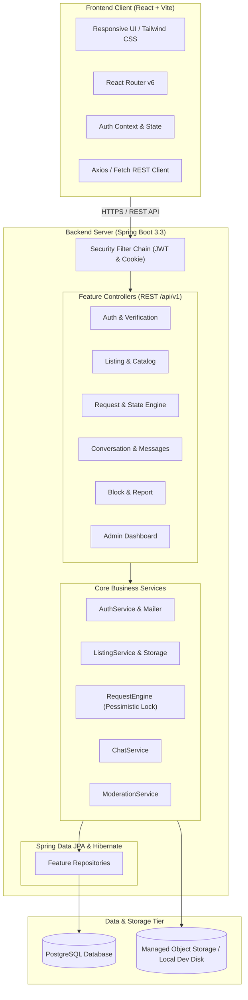
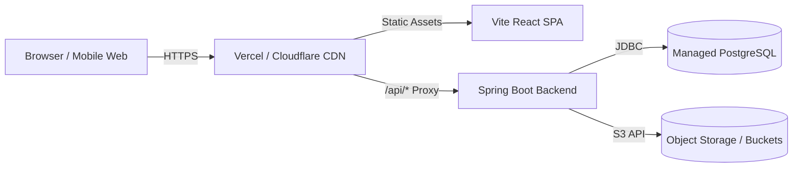

# System Architecture — Campus Exchange

**Document Version:** 1.0  
**Pattern:** Modular Monolith  
**Tech Stack:** Java 17 / Spring Boot 3.3.5 / PostgreSQL / React 18 / Vite / Tailwind CSS  

---

## 1. High-Level Architecture Overview

Campus Exchange is engineered as a clean **Modular Monolith**. It deliberately avoids distributed microservices in favor of high transactional integrity, simple deployment, and zero network serialization overhead.



---

## 2. Backend Package Structure

To maintain clean feature boundaries, high cohesion, and low coupling, the backend adopts a **feature-based** package structure:

```
com.campusexchange
├── CampusExchangeApplication.java
│
├── config
│   ├── AppProperties.java           # University domain, jwt secrets, upload limits
│   ├── CorsConfig.java              # CORS filters and origin management
│   ├── StorageConfig.java           # Local vs S3/R2 storage provider beans
│   └── SchedulingConfig.java        # Cron tasks (72-hour request expiry)
│
├── security
│   ├── JwtTokenProvider.java        # JWT creation, signature validation, parsing
│   ├── JwtAuthenticationFilter.java  # Cookie and Bearer header resolution
│   ├── SecurityConfig.java          # SecurityFilterChain and endpoint rules
│   ├── UserPrincipal.java           # Spring Security UserDetails adapter
│   └── CurrentUser.java             # Custom annotation for @AuthenticationPrincipal
│
├── common
│   ├── exception
│   │   ├── ApiException.java        # Base runtime exception with HTTP status
│   │   ├── ResourceNotFoundException.java
│   │   ├── UnauthorizedException.java
│   │   ├── ConflictException.java
│   │   └── GlobalExceptionHandler.java # Uniform JSON error formatting
│   ├── response
│   │   ├── ApiResponse.java         # Standard success envelope
│   │   └── PageResponse.java        # Standard pagination envelope
│   └── storage
│       ├── StorageService.java      # Interface for file upload/delete/url
│       └── LocalFileStorageService.java # Dev local disk implementation
│
├── auth
│   ├── controller.AuthController
│   ├── service.AuthService
│   ├── repository.EmailVerificationTokenRepo
│   ├── repository.PasswordResetTokenRepo
│   ├── dto.{RegisterRequest, LoginRequest, AuthResponse, PasswordResetRequest}
│   └── entity.{EmailVerificationToken, PasswordResetToken}
│
├── user
│   ├── controller.UserController
│   ├── service.UserService
│   ├── repository.UserRepository
│   ├── dto.{UserProfileDto, UpdateProfileRequest, PublicProfileDto}
│   └── entity.User
│
├── category
│   ├── controller.CategoryController
│   ├── service.CategoryService
│   ├── repository.CategoryRepository
│   ├── dto.{CategoryDto, CreateCategoryRequest}
│   └── entity.Category
│
├── listing
│   ├── controller.ListingController
│   ├── service.ListingService
│   ├── repository.ListingRepository
│   ├── repository.ListingImageRepository
│   ├── dto.{CreateListingRequest, UpdateListingRequest, ListingDetailDto, ListingCardDto}
│   └── entity.{Listing, ListingImage, ListingStatus, TransactionType, ItemCondition}
│
├── request
│   ├── controller.RequestController
│   ├── service.RequestService
│   ├── repository.ItemRequestRepository
│   ├── repository.ExchangeConfirmationRepository
│   ├── dto.{CreateRequestDto, RequestDetailDto, ConfirmExchangeDto}
│   └── entity.{ItemRequest, RequestStatus, ExchangeConfirmation, ConfirmationType}
│
├── conversation
│   ├── controller.ConversationController
│   ├── service.ConversationService
│   ├── repository.ConversationRepository
│   ├── repository.MessageRepository
│   ├── dto.{ConversationDto, MessageDto, SendMessageRequest}
│   └── entity.{Conversation, Message}
│
├── notification
│   ├── controller.NotificationController
│   ├── service.NotificationService
│   ├── repository.NotificationRepository
│   ├── dto.NotificationDto
│   └── entity.{Notification, NotificationType}
│
├── moderation
│   ├── controller.ModerationController
│   ├── service.ModerationService
│   ├── repository.ReportRepository
│   ├── repository.BlockedUserRepository
│   ├── dto.{CreateReportRequest, ReportDto, BlockUserRequest}
│   └── entity.{Report, BlockedUser, ReportReason, ReportStatus}
│
└── admin
    ├── controller.AdminController
    ├── service.AdminService
    ├── repository.AuditLogRepository
    ├── dto.{AdminStatsDto, UserModerationRequest, AuditLogDto}
    └── entity.{AuditLog, AuditAction}
```

---

## 3. Frontend Architecture

The frontend is built with React 18 and Vite, organized into modular slices:

```
src/
├── assets/                  # SVG icons, logo assets, placeholder illustrations
├── components/
│   ├── common/              # Button, Input, Modal, Badge, Toast, Spinner, EmptyState
│   ├── layout/              # Navbar, Footer, MobileBottomNav, Container
│   ├── listing/             # ListingCard, ImageGallery, ImageUploader, PriceTag
│   ├── request/             # RequestCard, RequestStatusBadge, ExpiryCountdown
│   └── chat/                # ConversationListItem, ChatWindow, MessageBubble
├── context/
│   ├── AuthContext.jsx      # Current user, login, logout, verification status
│   └── NotificationContext.jsx # Unread alerts, polling trigger
├── hooks/
│   ├── useDebounce.js       # Search input debouncing
│   ├── useChatPolling.js    # Efficient 3-second message polling
│   └── usePagination.js     # URL-query sync for catalog pagination
├── pages/
│   ├── auth/                # Login, Register, VerifyEmail, ForgotPassword
│   ├── marketplace/         # HomeCatalog, SearchPage
│   ├── listing/             # ListingDetail, CreateListing, EditListing
│   ├── requests/            # SentRequests, ReceivedRequests
│   ├── messages/            # ChatInbox, ActiveChat
│   ├── profile/             # UserProfile, MyListings
│   └── admin/               # AdminDashboard, AdminUsers, AdminListings, AdminReports
├── services/
│   ├── api.js               # Central Axios/Fetch wrapper with credentials: 'include'
│   └── authService.js, listingService.js, requestService.js, chatService.js
└── types/ or constants/     # Enums: TransactionType, Condition, RequestStatus
```

---

## 4. Storage Architecture (Hybrid Design)

To avoid hard dependency on expensive cloud providers during early development and local testing:
1. **`StorageService` abstraction:**
   ```java
   public interface StorageService {
       String store(MultipartFile file, String subDirectory);
       void delete(String storageKey);
       String getUrl(String storageKey);
   }
   ```
2. **Local Development:** `LocalFileStorageService` writes files to `./uploads/listings/` and serves them statically via a resource handler `/uploads/**`.
3. **Production Deployment:** Easily switched via Spring profile (`@Profile("prod")`) to an AWS S3 or Cloudflare R2 implementation without touching any controller or business service code.

---

## 5. Deployment Topology


