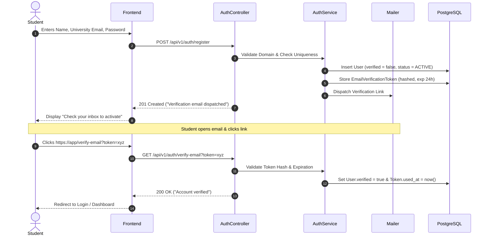
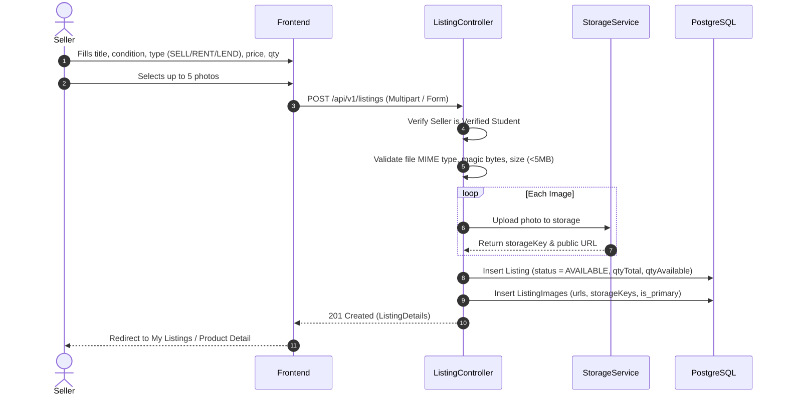
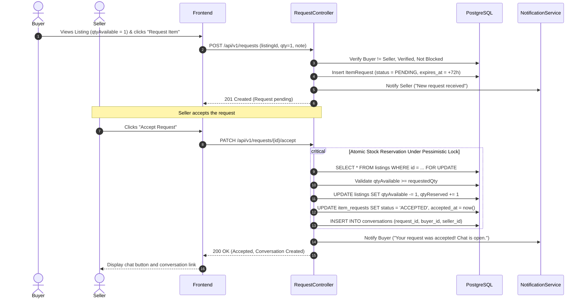
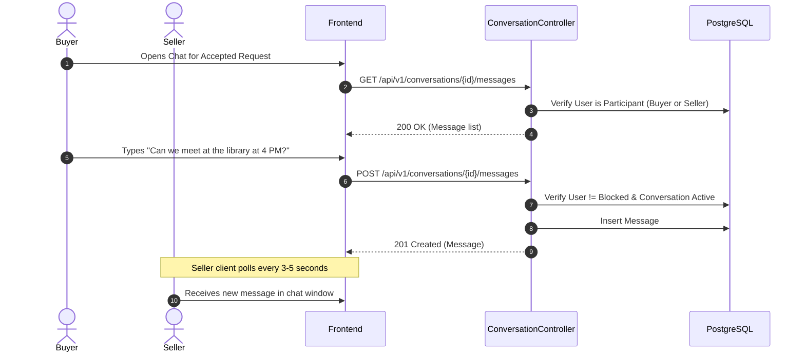
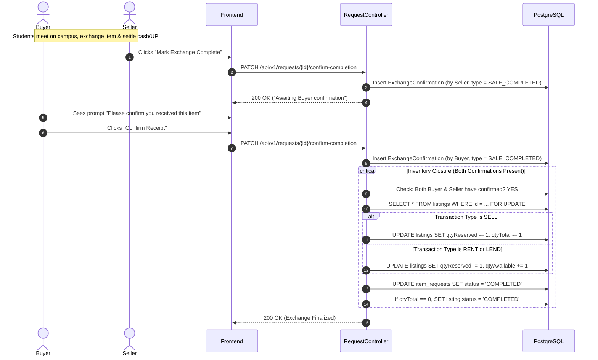
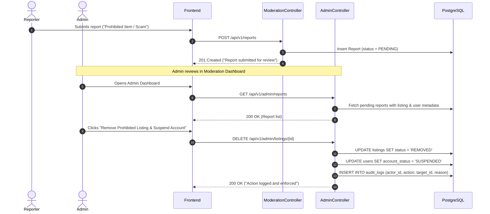

# User Flows & Sequence Diagrams — Campus Exchange

**Document Version:** 1.0  
**Status:** Architecture Blueprint  

---

## 1. Registration & University Email Verification Flow

Only students verified via approved university email domains (`@university.edu`) are permitted to list items or submit requests.

---

## 2. Listing Creation & Photo Upload Flow

Listings allow up to 5 photos, uploaded and validated before publishing.

---

## 3. Buyer Request Lifecycle & Atomic Stock Reservation

This flow guarantees that two buyers cannot reserve the last available item simultaneously.

---

## 4. Private Messaging Workflow (Post-Acceptance)

Unrestricted chat opens **strictly after** the seller accepts the request.

---

## 5. Mutual Exchange Completion Flow

Prevents one party from dishonestly completing or closing an exchange without the other party's confirmation.

---

## 6. Safety: Reporting & Blocking Flow

